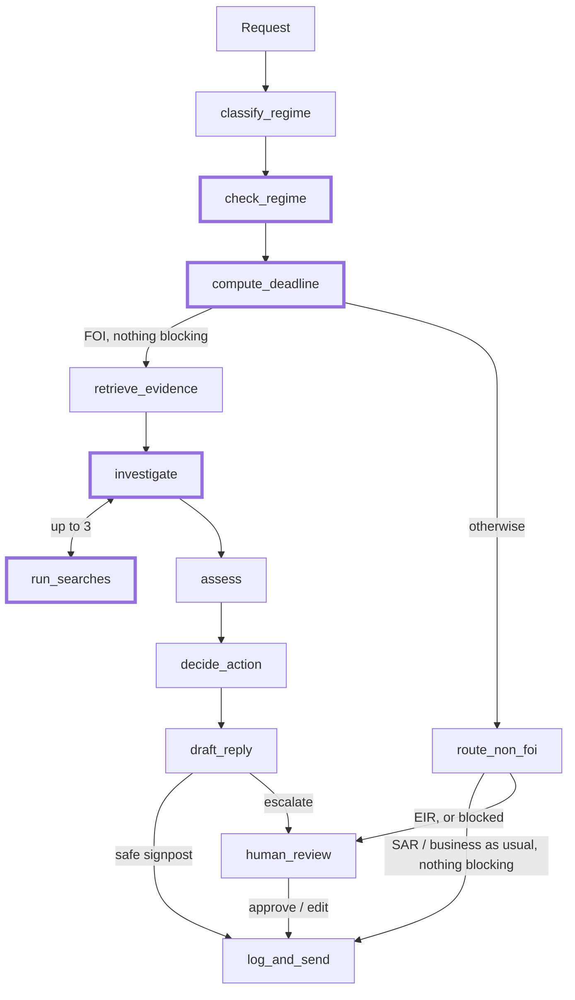

# FOI triage agent: handover

## What it does

- Triages Freedom of Information (FOI) requests to a UK council. Many are really a subject access request (SAR), an environmental request (EIR) or a service complaint.
- Decides the regime, sets the statutory deadline, checks what is already published and which exemptions apply, and drafts a reply.
- Acts on its own only to signpost published information, or to route a SAR or service request. Everything else goes to an FOI officer.
- **The model proposes, code decides.** Classification, assessment and drafting are model calls. Routing, the deadline and sending are tested code, because a sent reply can't be recalled.

## v1 and v2

The v2 graph. Thick borders mark what v2 added.

| | v1 | v2 |
| --- | --- | --- |
| Regime | The classifier alone | The classifier plus an independent check by a second model |
| Automatic send or route | Allowed if the classifier was at least 60% confident | Also needs the check to agree, and the request to be in English |
| Deadline | Clear FOI cases only, after routing | Every regime, before routing (SAR: one month) |
| Search | One BM25 search | Plus a bounded search tool (up to 3 read-only searches) |

## Results

**Held-out test split:** 21 examples that were never looked at or tuned on. Better and worse count examples that changed.

| Evaluator | v1 | v2 | Better | Worse |
| --- | --- | --- | --- | --- |
| `no_wrong_auto_action` (headline) | 81% | 100% | 4 | 0 |
| `no_unsafe_send` | 100% | 100% | 0 | 0 |
| `regime_correct` | 76% | 100% | 5 | 0 |
| `action_correct` | 65% | 86% | 4 | 0 |
| `deadline_correct` | 65% | 100% | 6 | 0 |
| `sends_when_expected` (n=5) | 40% | 60% | 1 | 0 |

- No example got worse on any evaluator, so the fixes generalise rather than fitting the examples I iterated on.
- On the 42 dev examples, the same pattern: `no_wrong_auto_action` 82% → 100%, `regime_correct` 79% → 95%, `action_correct` 73% → 83%, `deadline_correct` 61% → 100%. The 2 dev examples that got worse both escalated a case the agent could have handled.

## From eval finding to fix

| What the evals showed | What I changed | Result, v1 → v2 |
| --- | --- | --- |
| The classifier scored 55%: 16 of 30 FOI requests were confidently labelled SAR. BM25 over the five regime summaries often returned only the SAR one | The classifier sees all five summaries. Its criteria now say SAR means the requester's own data only | `regime_correct` 76% → 100% (test) |
| Grouped by slice, the adversarial requests scored 100% on `no_unsafe_send` but all 3 were routed automatically as SARs, a prompt injection among them | Widened the safety metric from sends to any automatic action | Adversarial slice: `no_wrong_auto_action` 0% → 100% (dev) |
| Confidence can't separate right from wrong: wrong automatic routes scored 0.86 to 1.00, right ones 0.61 to 0.99 | A second model checks the regime independently. Sending or routing needs it to agree, a clear regime, and a request in English | `no_wrong_auto_action` 81% → 100% (test) |
| EIR and unclear cases got no deadline, because only clear FOI cases reached that step | The deadline is set before routing, by regime (a SAR gets one month) | `deadline_correct` 65% → 100% (test) |
| The judge failed 13 escalated drafts for placeholders where an officer must add figures, which is correct behaviour. Two of its failures were real drafting errors | The judge judges by purpose (sent or escalated), on a different, pinned model. The draft prompt now tells the drafter never to contradict the assessment | `draft_judge_j2` 59% → 76% (dev, same judge on both) |
| s40 was raised on plain statistics | s40 only for identifiable people or small breakdowns | `exemption_precision` 64% → 83% (dev, n=7 and 10) |
| Some labels have more than one defensible answer | Listed eight for an FOI officer to settle, rather than relabelling them myself | Results on those examples are provisional |

**What I took from it:**
- Read the failures, then check the pattern by slice. The adversarial problem was invisible in the overall score.
- Check the evaluator before the agent. The first judge and a personal-data check (which flagged the ICO's own address) were both wrong.
- Retrieval should add evidence, not filter a classifier's options.

## How I know it's doing a good job

**Dataset:** [63 labelled requests](evals/datasets/golden.jsonl), split 42 dev and 21 held-out test (details in the [dataset README](evals/datasets/README.md)). Each request has a category from the brief, and a slice that points to the part of the agent it tests:

| Category | Slices |
| --- | --- |
| Normal (16) | `published` (signpost it), `plain_provide`, `routine` (a plain SAR, service request or EIR) |
| Edge (27) | `vocab_mismatch` (incl. a Polish request), `partly_published` (wrong year, multi-part), `exemption`, `not_held`, `too_broad`, `published`, `plain_provide` |
| High risk (20) | `regime_trap` (SARs and EIR worded as FOI, mixed requests), `adversarial` (prompt injection, abuse), `unsafe_send_bait` |

- Labels give the outcome an officer would want, not what the agent can do. 14 should be sent, so escalating everything also fails.
- Deadlines follow FOIA s10(6): bank holidays in any part of the UK count.
- Labels were committed before any run.

**Evaluators:** code wherever code can answer the question.

| Evaluators | Needs labels? | Runs on live traffic? | What they check |
| --- | --- | --- | --- |
| 8 checks | No (reference-free) | Yes | Citations were retrieved, exemptions are real FOIA sections, links come from the evidence, no personal data added, no placeholders in sent replies |
| 12 label checks | Yes | No | Regime, action, decision, published record, exemptions, deadline, retrieval recall. Headline: `no_wrong_auto_action` |
| 2 trajectory checks | Partly | Searches only | How often the tool searched, and whether it found relevant records the first search missed |
| LLM judge | Yes (reference-guided) | Not yet | Whether the draft is right for the case. On a different, pinned model, with its version in the score key |

The judge is the only model-based evaluator, kept for the one question code can't answer. On live traffic it would judge the draft against the agent's own decision, since there are no labels.

## Where it still struggles

- **A reply was sent with an officer note in it.** The send is decided before the draft is written. Fix: check the draft before sending.
- **A sent signpost didn't cite s21,** which the law requires. Fix: a template for sent replies, with code adding the legal wording.
- **Caution costs sends.** `sends_when_expected` is still 56%. The regime check called a parking request EIR in one run and FOI in the next.
- **No "not held" or "clarify" outcome.** Left out on purpose. The agent can't reliably know who does hold the information. And asking the requester to clarify stops the 20-day clock, which starts again from day one when they reply, so it changes the legal deadline and shouldn't be automatic yet.
- **The judge isn't calibrated** against human labels yet.
- **Small numbers.** Some slices have 3 to 5 examples, test has 21, and outputs vary between runs.

## Why there's no truly useful tool

- **FOI is a fixed, regulated process.** The steps don't change between requests, so they're separate nodes with routing in code, not one agent choosing between tools.
- **That's safer and easier to evaluate.** Sending and routing are tested rules, and each node has its own evaluators, so a failure points to one step.
- **More tools and agency would tick the brief's box,** at the cost of safety and evaluation. For an agent writing to the public for a council, I chose control.
- **The one tool I tested is read-only search** (up to 3 searches before assessment):

| | With tool | Without |
| --- | --- | --- |
| `action_correct` | 83% | 83% |
| Cost | $0.046 | $0.034 |

- It averaged 2.84 searches per FOI case and changed no outcome, often searching for evidence it already had. At this corpus size, one BM25 search is enough, so the tool is a switch (`FOI_SEARCH_TOOL`), not a claimed improvement.
- A tool would earn its place with real case systems, such as checking a requester's earlier requests for repeats (s14).

## Evaluating in production

- Turn the label-free checks into a LangSmith online evaluator, so every new trace is scored automatically. Today [score_traces.py](evals/score_traces.py) does this by hand.
- Run the judge on a sample, against the agent's own decision, since live traffic has no labels.
- Use officer decisions as labels. The review UI already logs approve, edit and reject as feedback.
- Send failures to an annotation queue, and add confirmed cases to the golden set.
- Watch wrong automatic actions, the escalation rate and missed deadlines.

## Traces and experiments

**[Open the dataset and experiments in LangSmith](https://smith.langchain.com/public/804b9bd4-47cf-413d-b42a-32f0f1798ba4/d)** (public link).

1. On the Experiments tab, tick the two experiments in a row of the table below and click **Compare**. Each example then shows both runs side by side, with every evaluator's score.
2. Click any example to open its trace: every step, each model call with its prompt and output, and each search with the records it returned.
3. Group by the `slice` or `category` metadata to see results by type of request. For example, `adversarial` shows the automatic routes v1 got wrong.

| Comparison | Experiments, before → after |
| --- | --- |
| **v1 → v2 on the held-out test split** (the main result) | `v1-full-test-633b6b3c` → `v2-full-test-0ea786b4` |
| v1 → v2 on dev | `v1-full-dev-baseline-09001cf0` → `v2-full-dev-626a3f63` |
| The classifier fix within v1: retrieved guidance (55%) → all guidance | `v1-classify-dev-e80d9114` → `v1-full-dev-baseline-09001cf0` |
| The search tool: without → with, both v2 on dev | `v2-full-dev-notool-a63ad266` → `v2-full-dev-626a3f63` |

To reproduce them, see the Evaluation section of the [README](README.md).

## Extras from the brief

| Extra | Where |
| --- | --- |
| Results by slice | Every example has a slice and a category (normal, edge, high risk). Filter by them in any experiment |
| Tool calls and trajectories | `searches_made` and `tool_found_relevant`, and the with/without comparison above |
| Intentionally tricky examples | 20 high-risk examples: SARs worded as FOI, prompt injection, unsafe-send bait, a Polish request |
| Online evaluation | [score_traces.py](evals/score_traces.py) scores live traces and attaches the results as feedback. Officer decisions in the UI are logged as feedback too |
| PII and guardrails | No automatic action unless the regime check agrees; a check for personal data added to replies; injected instructions can't trigger a send, because sending is code |
| Streaming | The demo UI streams each case through the graph, node by node |
| Judge calibration | Not done. The plan: label about 20 drafts blind and measure agreement with the judge, especially drafts it passes that a human would fail |
| Setup script or Docker | Not done. Setup is the four Quickstart commands in the README |

## How I used a coding assistant

I used Claude Code throughout, but the decisions were mine.

1. **Planning by hand.** I chose the use case and mapped its decisions myself: the judgements, what each costs if wrong, and which can be undone. That gave the design rules: code decides automatic actions, escalate when unsure.
2. **The first build, back and forth with the agent.** I planned the v1 implementation together with Claude Code, then it wrote most of the code, the fictional knowledge base, the first draft of the labels and the evaluators, partly with subagents working in parallel.
3. **Reviewing the evals.** I worked through the experiments in the LangSmith UI and read the important traces myself. I used agents for the bigger pieces of data, such as comparing every example across two runs. The findings came from my own reading: the judge failing correct placeholder drafts, the wrongly labelled planning request, the reply sent with an officer note, the missing s21, and that the tool comparison was within noise.
4. **Planning v2 from my findings.** I worked out the v2 improvements with the agent, choosing what to fix and what to leave out, such as "not held" and "clarify", before it built them.
5. **Checking the assistant's work.** I flagged the disputed labels for an FOI officer rather than accepting the drafted ones, and questioned results that looked too good, such as the no-tool run.
