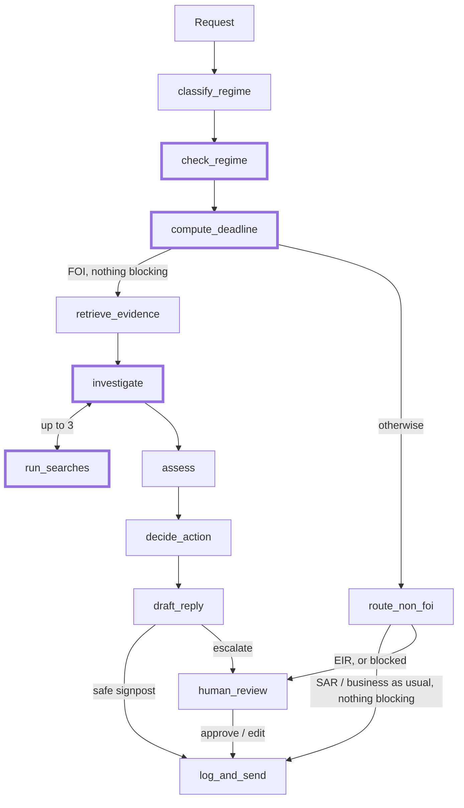

# FOI triage agent: handover

## What it does

- Triages Freedom of Information (FOI) requests to a UK council. Many are really a subject access request (SAR), an environmental request (EIR) or a service complaint.
- Decides the regime, sets the statutory deadline, checks what is already published and which exemptions apply, and drafts a reply.
- Acts on its own only to signpost published information, or to route a SAR or service request. Everything else goes to an FOI officer.
- **The model proposes, code decides.** Classification, assessment and drafting are model calls. Routing, the deadline and sending are tested code, because a sent reply can't be recalled.

## v1 and v2

The v2 graph. Thick borders mark what v2 added.

| | v1 | v2 |
| --- | --- | --- |
| Regime | The classifier alone | The classifier plus an independent check by a second model |
| Automatic send or route | Allowed if the classifier was at least 60% confident | Also needs the check to agree, and the request to be in English |
| Deadline | Clear FOI cases only, after routing | Every regime, before routing (SAR: one month) |
| Search | One BM25 search | Plus a bounded search tool (up to 3 read-only searches) |

## Results

**Held-out test split:** 21 examples that were never looked at or tuned on. Better and worse count examples that changed.

| Evaluator | v1 | v2 | Better | Worse |
| --- | --- | --- | --- | --- |
| `no_wrong_auto_action` (headline) | 81% | 100% | 4 | 0 |
| `no_unsafe_send` | 100% | 100% | 0 | 0 |
| `regime_correct` | 76% | 100% | 5 | 0 |
| `action_correct` | 65% | 86% | 4 | 0 |
| `deadline_correct` | 65% | 100% | 6 | 0 |
| `draft_judge_j2` (same judge on both) | 55% | 67% | 0 | 0 |
| `sends_when_expected` (n=5) | 40% | 60% | 1 | 0 |

**Dev split:** the 42 examples I iterated on.

| Evaluator | v1 | v2 | Better | Worse |
| --- | --- | --- | --- | --- |
| `no_wrong_auto_action` (v1 scored on 34 runs) | 82% | 100% | 6 | 0 |
| `regime_correct` | 79% | 95% | 7 | 1 |
| `action_correct` | 73% | 83% | 7 | 2 |
| `deadline_correct` | 61% | 100% | 12 | 0 |
| `draft_judge_j2` (same judge on both) | 59% | 76% | 2 | 0 |
| `sends_when_expected` (n=9) | 56% | 56% | 2 | 2 |

- v2 has no wrong automatic actions and every deadline is right, on both splits.
- On test, no example got worse on any evaluator, so the fixes generalise rather than fitting the dev examples.
- The 2 dev examples that got worse both escalated a case the agent could have handled. When unsure, an officer looks.

## How I know it's doing a good job

**Dataset:** [63 labelled requests](evals/datasets/golden.jsonl) (details in the [dataset README](evals/datasets/README.md)).
- 16 normal, 27 edge cases, 20 high-risk failures.
- Includes SARs worded as FOI, prompt injection, a Polish request, and requests built to tempt a wrong send.
- Labels give the outcome an officer would want. 14 should be sent, so escalating everything also fails.
- Deadlines follow FOIA s10(6): bank holidays in any part of the UK count.
- Labels were committed before any run.

**Evaluators:** code wherever code can answer the question.
- **8 label-free checks,** which also run on live traces: citations retrieved, real FOIA sections, links from the evidence, no added personal data, no placeholders in sent replies.
- **12 label checks:** regime, action, decision, published record, exemptions, deadline, retrieval recall. The headline is `no_wrong_auto_action`, because a wrong send or route is the harm that can't be undone.
- **2 trajectory checks** on the search tool.
- **An LLM judge** for the one thing code can't check: is the draft right for the case. It runs on a different, pinned model, and its version is in the score key.

## What the evals taught me

1. **Retrieval was filtering the classifier's options.**
   - The first classification run scored 55%, with 16 of 30 FOI requests confidently labelled SAR.
   - BM25 over the five regime summaries often returned only the SAR one.
   - With all five supplied, it reached 78%, so I removed the retrieval step.
2. **Confidence doesn't separate right from wrong.**
   - Wrong automatic routes had confidence 0.86 to 1.00, right ones 0.61 to 0.99.
   - So v2 adds a second model's independent view of the regime, and an automatic action needs it to agree.
3. **Routing is an automatic action too.**
   - Six FOI requests, including a prompt injection, got an automatic "this is a SAR" reply.
   - The safety metric only counted sends, so I widened it.
4. **The first judge was measuring something impossible.**
   - It failed 13 escalated drafts for placeholders where an officer must supply figures, which is correct behaviour.
   - I fixed the rubric to judge by purpose rather than make the judge lenient, because two of its failures were real errors.
5. **Some labels are disputed.** I listed eight for an FOI officer to settle rather than relabelling them myself.

## Where it still struggles

- **A reply was sent with an officer note in it.** The send is decided before the draft is written. Fix: check the draft before sending.
- **A sent signpost didn't cite s21,** which the law requires. Fix: a template for sent replies, with code adding the legal wording.
- **Caution costs sends.** `sends_when_expected` is still 56%. The regime check called a parking request EIR in one run and FOI in the next.
- **No "not held" or "clarify" outcome.** Left out on purpose: the agent can't know who holds the information, and clarifying restarts the clock.
- **The judge isn't calibrated** against human labels yet.
- **Small numbers.** Some slices have 3 to 5 examples, test has 21, and outputs vary between runs.

## Why there's no truly useful tool

- **FOI is a fixed, regulated process.** The steps don't change between requests, so they're separate nodes with routing in code, not one agent choosing between tools.
- **That's safer and easier to evaluate.** Sending and routing are tested rules, and each node has its own evaluators, so a failure points to one step.
- **More tools and agency would tick the brief's box,** at the cost of safety and evaluation. For an agent writing to the public for a council, I chose control.
- **The one tool I tested is read-only search** (up to 3 searches before assessment):

| | With tool | Without |
| --- | --- | --- |
| `action_correct` | 83% | 83% |
| Cost | $0.046 | $0.034 |

- It averaged 2.84 searches per FOI case and changed no outcome, often searching for evidence it already had. At this corpus size, one BM25 search is enough, so the tool is a switch (`FOI_SEARCH_TOOL`), not a claimed improvement.
- A tool would earn its place with real case systems, such as checking a requester's earlier requests for repeats (s14).

## Evaluating in production

- Run the label-free checks on every trace. [score_traces.py](evals/score_traces.py) already attaches them as LangSmith feedback.
- Run the judge on a sample, against the agent's own decision, since live traffic has no labels.
- Use officer decisions as labels. The review UI already logs approve, edit and reject as feedback.
- Send failures to an annotation queue, and add confirmed cases to the golden set.
- Watch wrong automatic actions, the escalation rate and missed deadlines.

## Traces and experiments

**[Open the dataset and experiments in LangSmith](https://smith.langchain.com/public/804b9bd4-47cf-413d-b42a-32f0f1798ba4/d)** (public link). Each experiment row opens its traces, and the Compare view puts runs side by side.

| Experiment | What it is |
| --- | --- |
| `v1-classify-dev-e80d9114` | Classifier with retrieved guidance (55%) |
| `v1-full-dev-baseline-09001cf0` | v1 baseline |
| `v2-full-dev-626a3f63` | v2 with the search tool |
| `v2-full-dev-notool-a63ad266` | v2 without the search tool |
| `v1-full-test-633b6b3c` | v1 on the held-out test split |
| `v2-full-test-0ea786b4` | v2 on the held-out test split |

To reproduce them, see the Evaluation section of the [README](README.md).

## How I used a coding assistant

I used Claude Code throughout, but the decisions were mine.

1. **Planning by hand.** I chose the use case and mapped its decisions myself: the judgements, what each costs if wrong, and which can be undone. That gave the design rules: code decides automatic actions, escalate when unsure.
2. **The first build, back and forth with the agent.** I planned the v1 implementation together with Claude Code, then it wrote most of the code, the fictional knowledge base, the first draft of the labels and the evaluators, partly with subagents working in parallel.
3. **Reviewing the evals.** I worked through the experiments in the LangSmith UI and read the important traces myself. I used agents for the bigger pieces of data, such as comparing every example across two runs. The findings came from my own reading: the judge failing correct placeholder drafts, the wrongly labelled planning request, the reply sent with an officer note, the missing s21, and that the tool comparison was within noise.
4. **Planning v2 from my findings.** I worked out the v2 improvements with the agent, choosing what to fix and what to leave out, such as "not held" and "clarify", before it built them.
5. **Checking the assistant's work.** I flagged the disputed labels for an FOI officer rather than accepting the drafted ones, and questioned results that looked too good, such as the no-tool run.
