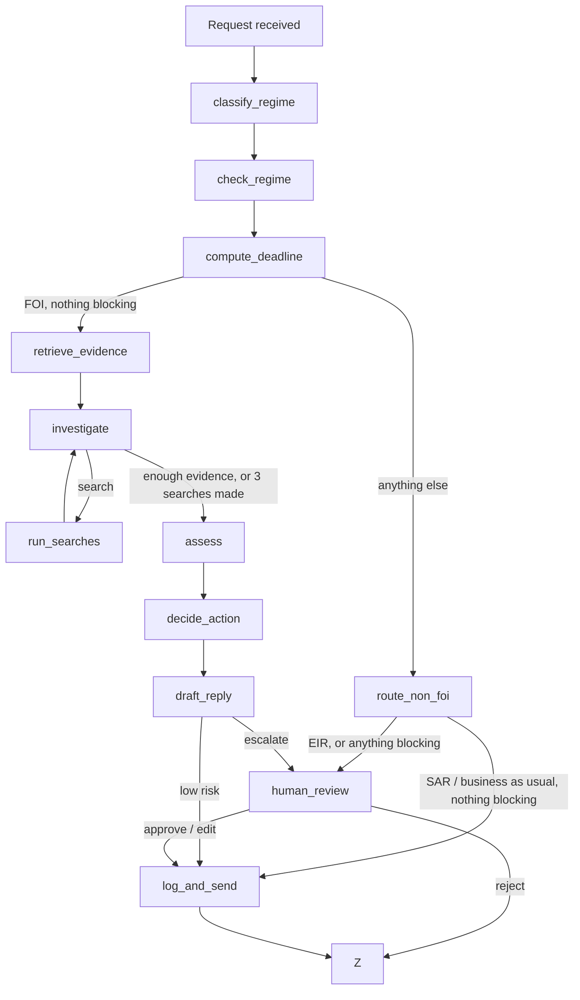

# FOI Agent

An agent that triages Freedom of Information (FOI) requests for a UK council.

It works out what kind of request has come in, routes anything that isn't FOI to the right place, and uses ICO guidance and the council's past published responses to set the deadline and flag likely exemptions. It only replies on its own in low-risk cases, such as pointing the requester to information that's already published. Everything else goes to an FOI officer with a suggested decision and a draft reply.

## Stack

- Python
- LangGraph (LangGraph Studio for development)
- OpenAI `gpt-6-luna` for the independent regime check, the search tool, assessment and drafting (set `FOI_MODEL` to use another model)
- A decision model for regime classification, `semif-qwen3.5-4b` through `langchain-typesafe` and the LangSmith Gateway (set `FOI_CLASSIFIER_MODEL` to use another model)
- BM25 retrieval (`rank-bm25`) over a small knowledge base
- LangSmith for tracing and evaluation, with an LLM judge on a different, pinned OpenAI model (`gpt-5.5-2026-04-23`)

## Quickstart

Requires Python 3.11 or later.

macOS / Linux:

```bash
python -m venv .venv
source .venv/bin/activate
pip install -e ".[dev]"
cp .env.example .env
```

Windows (PowerShell):

```powershell
python -m venv .venv
.venv\Scripts\Activate.ps1
pip install -e ".[dev]"
Copy-Item .env.example .env
```

Then add your API keys to `.env`: `OPENAI_API_KEY` for OpenAI, and `LANGSMITH_API_KEY`, which the regime classifier needs as well as tracing.

Check the setup:

```bash
python -m pytest
python -m ruff check .
```

The tests use fake models, so they make no API calls.

## Run it

One request from the command line. Escalated cases pause for officer review; add `--review approve` or `--review reject` to decide them:

```bash
python -m foi_agent "How much is the chief executive paid?" --received 2026-10-26
python -m foi_agent --file examples/requests.jsonl --line 5
```

[examples/requests.jsonl](examples/requests.jsonl) holds sample requests, each with a note on the path it exercises.

In LangGraph Studio:

```bash
langgraph dev
```

On Windows machines where the venv's `.exe` launchers are blocked, run `python -c "from langgraph_cli.cli import cli; cli()" dev` instead.

Replies are written to `var/outbox/` and each case is appended to `var/case_log.jsonl`. Nothing is emailed. Set `FOI_OUTPUT_DIR` to write somewhere else.

### Demo UI

A small web app over the same graph, built with FastAPI, Jinja2 and HTMX. It has two pages: **Triage**, to run a request and watch it go through the graph, and **Review**, the FOI officer's queue of escalated cases.

1. Install the demo extra, in the same virtual environment as the Quickstart:

   ```bash
   pip install -e ".[demo]"
   ```

2. Check `.env` has `OPENAI_API_KEY` and `LANGSMITH_API_KEY`, as for the command line. The server reads `.env` when it starts.

3. Start the server from the repo root:

   ```bash
   python -m uvicorn foi_agent.web.app:app --reload
   ```

   On Windows with the venv activated, the same command works in PowerShell. Where the venv's `.exe` launchers are blocked, call its Python directly: `.venv\Scripts\python -m uvicorn foi_agent.web.app:app --reload`.

4. Open http://127.0.0.1:8000. Add `--port 8001` to the command if 8000 is taken.

On **Triage**, type a request, or open **Sample requests** and pick one, then choose **Triage**. The path through the graph streams in node by node over server-sent events. The result shows:

- the regime probabilities against the threshold, and the deadline;
- why the case was sent, routed or escalated;
- the assessment, the evidence and the draft reply;
- the [checks](#checks);
- for a request in the golden dataset, the run set against its label field by field;
- with tracing on, a link to the run's LangSmith trace.

On **Review**, the queue holds cases paused at `human_review`, soonest deadline first. The officer sends the reply, editing it first if it needs changing, or rejects it, and the graph resumes. A reply sent with changes is recorded as an edit. With tracing on, the decision is attached to the triage run in LangSmith as feedback: `officer_review`, plus `draft_edited` when the officer changed the reply.

Things to know:

- **Cost.** Each triage is a full run, with the same model calls as the command line. A run finishes even if you leave the page.
- **Replays.** The last run of each sample request is saved to `var/demo_runs/`. **Show last run** replays it without calling a model, which is useful for a demo or recording.
- **Storage.** Cases and checkpoints are kept in `var/web.sqlite`, so the review queue survives a restart. Stop the server and delete `var/web.sqlite` and `var/demo_runs/` to start afresh.
- **Local only.** The app has no login, so keep it on 127.0.0.1.

## How it works



| Node | Type | What it does |
| --- | --- | --- |
| `classify_regime` | Judgement (decision model) | FOI, EIR, SAR or business as usual, with a probability for each. It is given the ICO guidance summary for every regime, every time |
| `check_regime` | Judgement (LLM) | An independent second opinion on the regime from a different model, which isn't shown the classifier's answer |
| `compute_deadline` | Deterministic | By the classifier's regime: 20 working days for FOI and EIR, skipping weekends and bank holidays in any part of the UK (FOIA s10(6)); one calendar month for a SAR; none for business as usual |
| `route_non_foi` | Deterministic | SAR and business as usual get a template acknowledgement naming the team it has gone to, but only if nothing blocks an automatic action. EIR, and any case with a blocker, escalates |
| `retrieve_evidence` | Retrieval | Searches the disclosure log, publication scheme and exemption guidance using the request text |
| `investigate`, `run_searches` | Tool use (LLM) | The model may search the same three sources again, in its own words, at most 3 times, before assessment. Read-only. Turn it off with `FOI_SEARCH_TOOL=0` |
| `assess` | Judgement (LLM) | Already published (and where), possible exemptions, recommended decision, evidence relied on |
| `decide_action` | Deterministic | Sends only a signpost to a retrieved publication scheme record or fully released disclosure log entry, with no exemption other than s21 and nothing blocking an automatic action. Everything else escalates, with the reasons |
| `draft_reply` | Judgement (LLM) | Plain-English reply grounded in the assessment and evidence. Information an officer must supply is left as `[OFFICER: …]` |
| `human_review` | Interrupt | Officer approves, edits or rejects escalated cases |
| `log_and_send` | Deterministic | Writes the reply to the outbox and appends to the case log |

The agent acts on its own in two ways: sending a signpost and routing a SAR or business-as-usual case. Both are blocked, and the case escalates, if any of these holds:

- the classifier's top regime is below `REGIME_MIN_PROB` (0.6);
- the independent regime check disagrees with the classifier;
- the request may not be in English.

## Observability

Every run is traced to LangSmith when `LANGSMITH_TRACING=true`. A trace shows each node, every model call with its prompt and structured output, and each BM25 search as a retriever span listing the records it returned with their scores.

Every run carries metadata, so traces and experiments can be filtered and compared:

| Key | Value |
| --- | --- |
| `agent_version` | `AGENT_VERSION` in [graph.py](src/foi_agent/graph.py), the agent's release, which also names experiments (`v2-full-dev-…`) |
| `model` | The LLM in use for assessment and drafting (`FOI_MODEL`) |
| `classifier_model` | The regime classifier's decision model (`FOI_CLASSIFIER_MODEL`) |
| `prompt_version` | `PROMPT_VERSION` in [prompts.py](src/foi_agent/prompts.py), bumped whenever a prompt or the classifier's question changes |
| `retriever`, `retrieval_k` | The retrieval method and the number of records taken from each source |
| `search_tool`, `max_searches` | Whether the search tool is on, and its limit |
| `corpus_version` | A hash of the knowledge base files, which changes whenever the data does |
| `thread_id` | The case id, added by LangGraph |

Experiments also record `judge_model`, `judge_version` and `checks_version`, and LangSmith adds the git commit. Runs from the command line are also tagged `cli`. Runs from the sample file record the line they came from as `example`.

Traces store the request text in full, and real requests can contain personal data. That's acceptable for a prototype with invented requests, but a live deployment would need to mask inputs before they leave the council.

## Checks

[checks.py](src/foi_agent/checks.py) holds code checks that score a finished run without needing labels. Each one takes the run's final state as `outputs`, so it can be used as a LangSmith evaluator or applied to traced runs. A check that doesn't apply to a run, such as draft checks on a routed SAR, scores `None`.

| Check | Step | Fails when |
| --- | --- | --- |
| `evidence_found` | Retrieve evidence | An FOI case found no published record or past response |
| `citations_grounded` | Assess | The assessment cites an id that wasn't retrieved |
| `assessment_consistent` | Assess | The decision contradicts its own fields, for example a signpost that isn't marked as published |
| `exemption_sections_known` | Assess | An exemption isn't a real FOIA section |
| `draft_links_grounded` | Draft reply | The reply links to a URL that isn't in the evidence and isn't the council's or the ICO's |
| `draft_states_rights` | Draft reply | The reply doesn't mention internal review and the ICO |
| `draft_no_new_personal_data` | Draft reply | The reply contains an email address, phone number, National Insurance number or postcode that wasn't in the request, other than the council's or the ICO's |
| `sent_draft_complete` | Draft reply | A reply that was sent contains a placeholder, such as `[OFFICER: …]` |

To score traced runs and attach the results to them in LangSmith as feedback:

```bash
python evals/score_traces.py --dry-run   # print scores only
python evals/score_traces.py             # write them to LangSmith
```

The script reads existing traces and makes no model calls. Running it again replaces earlier scores rather than adding to them. Each score records a `checks_version`, a hash of `checks.py`, so scores from changed checks can be told apart. The default project is `foi-agent-local`, where LangSmith files traces sent with the agent settings in `.env`. Use `--project` to score another project.

## Evaluation

[evals/datasets/golden.jsonl](evals/datasets/golden.jsonl) holds 63 labelled requests covering normal cases, edge cases and high-risk failures. [evals/datasets/README.md](evals/datasets/README.md) explains the labels, what each slice tests, the known gaps and how the before and after are kept honest. `python -m pytest tests/test_golden_dataset.py` checks the labels for format errors and unknown ids.

Upload the dataset to LangSmith as `foi-golden`. Running it again updates the examples instead of duplicating them:

```bash
python -m evals.upload_dataset
```

Run an experiment:

```bash
python -m evals.run_experiment --split dev --limit 5      # a cheap first run
python -m evals.run_experiment --split dev --classify-only # regime classification only, no OpenAI calls
python -m evals.run_experiment --split dev --repetitions 2 # the full dev split, each example twice
python -m evals.run_experiment --split dev --no-search-tool # the same without the search tool, for comparison
```

Every case makes one OpenAI call for the regime check. An FOI case that reaches assessment makes 3 to 5 more: 1 to 3 for the search tool, then assess and draft. The judge adds one per draft (skip it with `--no-judge`). Use `--slice` to run one slice and `--pause` to space out requests. Every experiment records its run metadata, and its summary by category and slice is saved to `evals/results/`.

To apply new or changed evaluators to an existing experiment without rerunning the agent, which makes no OpenAI calls unless the judge is included:

```bash
python -m evals.run_experiment --rescore EXPERIMENT_NAME --only no_wrong_auto_action sent_draft_complete
```

Each run is scored by three kinds of evaluator:

| Kind | Where | What it scores |
| --- | --- | --- |
| Code checks, no labels needed | [checks.py](src/foi_agent/checks.py) | Grounded citations, consistent assessments, links, personal data, the requester's rights (see [Checks](#checks)) |
| Code compared with the labels | [evaluators.py](evals/evaluators.py) | `regime_correct`, `regime_check_correct`, `action_correct`, `no_wrong_auto_action`, `no_unsafe_send`, `sends_when_expected`, `decision_correct`, `published_match`, `exemption_recall` and `exemption_precision`, `deadline_correct`, `retrieval_recall` |
| Trajectory | [evaluators.py](evals/evaluators.py) | `searches_made` (how often the search tool was used) and `tool_found_relevant` (relevant records only the tool found) |
| LLM judge | [judge.py](evals/judge.py) | Whether the draft is right for the case, grounded in the evidence and clear. It judges a sent reply as finished, and an escalated draft as a starting point for an officer, where marked placeholders are fine but invented facts are not. It runs on `gpt-5.5-2026-04-23` by default (`FOI_JUDGE_MODEL`), so it isn't judging its own model's drafts. Its score key includes its version (`draft_judge_j2`), so scores from different judges are never mixed |

`no_wrong_auto_action` is the headline: the agent must never send or route a case an officer should have seen. `no_unsafe_send` counts sends only. `sends_when_expected` measures the cost of caution, because escalating a safe signpost wastes an officer's time.

## Knowledge base

The council is fictional: Northbrook Borough Council. The knowledge base lives in [src/foi_agent/data/](src/foi_agent/data/):

| File | Contents |
| --- | --- |
| `regime_guidance.json` | Summaries of ICO guidance on FOI, EIR, subject access, business as usual and mixed requests, all given to the classifier |
| `exemption_guidance.json` | Summaries of ICO guidance on s12, s14, s21, s22, s31, s40, s41, s42 and s43 |
| `disclosure_log.json` | Past FOI and EIR responses the council has published |
| `publication_scheme.json` | Datasets the council publishes routinely, mostly under the Local Government Transparency Code |
| `bank_holidays.json` | UK bank holidays for England and Wales, Scotland and Northern Ireland, 2019 to 2028, from [gov.uk](https://www.gov.uk/bank-holidays.json), used by the deadline |

The ICO summaries contain public sector information licensed under the Open Government Licence v3.0. The disclosure log and publication scheme are invented.

## Why the agent is cautious

The costly mistakes are the ones that can't be undone once a reply is sent. A Subject Access Request answered as FOI effectively publishes someone's personal data, and a wrong refusal or disclosure can lead to an ICO complaint. So the agent classifies the regime first, has a second model check it independently, escalates when the two disagree or no regime is clearly ahead, keeps the send/escalate decision as a plain rule rather than an LLM call, and defaults to escalating.
