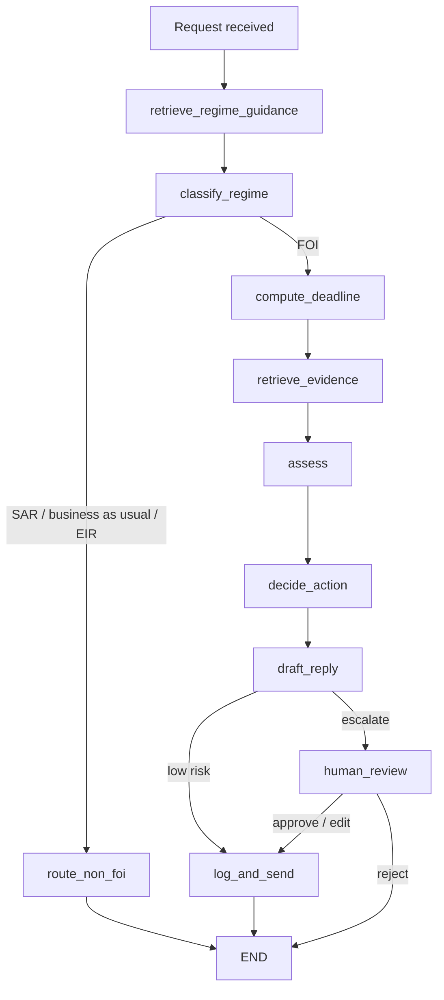

# FOI Agent

An agent that triages Freedom of Information (FOI) requests for a UK council.

It works out what kind of request has come in, routes anything that isn't FOI to the right place, and uses ICO guidance and the council's past published responses to set the deadline and flag likely exemptions. It only replies on its own in low-risk cases, such as pointing the requester to information that's already published. Everything else goes to an FOI officer with a suggested decision and a draft reply.

## Stack

- Python
- LangGraph (LangGraph Studio for development)
- LangSmith for tracing and evaluation
- HTMX for the officer review UI

## How it works

| Node | Type | What it does |
| --- | --- | --- |
| `retrieve_regime_guidance` | Retrieval | Searches ICO guidance using the request text |
| `classify_regime` | Judgement (LLM) | FOI, EIR, SAR or business as usual |
| `route_non_foi` | Deterministic | SAR and business as usual get a routed acknowledgement; EIR escalates |
| `compute_deadline` | Deterministic | 20 working days from receipt |
| `retrieve_evidence` | Retrieval | Searches the disclosure log and exemption guidance |
| `assess` | Judgement (LLM) | Already published, too broad, exemptions, cost limit, recommended decision, cited sections |
| `decide_action` | Deterministic | Escalation rule over the assessment |
| `draft_reply` | Judgement (LLM) | Plain-English reply grounded in the cited sections |
| `human_review` | Interrupt | Officer approves, edits or rejects escalated cases |
| `log_and_send` | Deterministic | Appends to the case log and sends |

## Why the agent is cautious

The costly mistakes are the ones that can't be undone once a reply is sent. A Subject Access Request answered as FOI effectively publishes someone's personal data, and a wrong refusal or disclosure can lead to an ICO complaint. So the agent classifies the regime first, keeps the send/escalate decision as a plain rule rather than an LLM call, and defaults to escalating.
