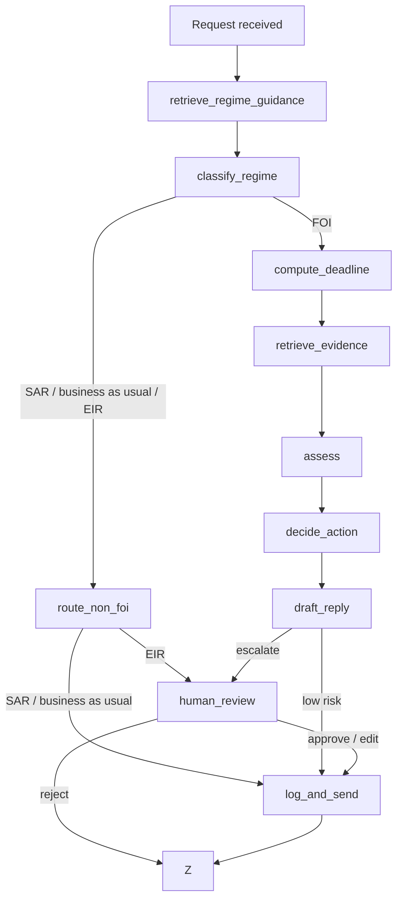

# FOI Agent

An agent that triages Freedom of Information (FOI) requests for a UK council.

It works out what kind of request has come in, routes anything that isn't FOI to the right place, and uses ICO guidance and the council's past published responses to set the deadline and flag likely exemptions. It only replies on its own in low-risk cases, such as pointing the requester to information that's already published. Everything else goes to an FOI officer with a suggested decision and a draft reply.

## Stack

- Python
- LangGraph (LangGraph Studio for development)
- Gemini 3.6 Flash on the Gemini API free tier (set `FOI_MODEL` to use another model)
- BM25 retrieval (`rank-bm25`) over a small knowledge base
- LangSmith for tracing and evaluation

## Quickstart

Requires Python 3.11 or later.

macOS / Linux:

```bash
python -m venv .venv
source .venv/bin/activate
pip install -e ".[dev]"
cp .env.example .env
```

Windows (PowerShell):

```powershell
python -m venv .venv
.venv\Scripts\Activate.ps1
pip install -e ".[dev]"
Copy-Item .env.example .env
```

Then add your API keys to `.env`.

Check the setup:

```bash
pytest
ruff check .
```

## Run it

One request from the command line. Escalated cases pause for officer review; add `--review approve` or `--review reject` to decide them:

```bash
python -m foi_agent "How much is the chief executive paid?" --received 2026-10-26
python -m foi_agent --file examples/requests.jsonl --line 5
```

[examples/requests.jsonl](examples/requests.jsonl) holds sample requests, each with a note on the path it exercises.

In LangGraph Studio:

```bash
langgraph dev
```

On Windows machines where the venv's `.exe` launchers are blocked, run `python -c "from langgraph_cli.cli import cli; cli()" dev` instead.

Replies are written to `var/outbox/` and each case is appended to `var/case_log.jsonl`. Nothing is emailed. Set `FOI_OUTPUT_DIR` to write somewhere else.

## How it works



| Node | Type | What it does |
| --- | --- | --- |
| `retrieve_regime_guidance` | Retrieval | Searches the ICO regime guidance using the request text |
| `classify_regime` | Judgement (LLM) | FOI, EIR, SAR or business as usual |
| `route_non_foi` | Deterministic | SAR and business as usual get a template acknowledgement naming the team it has gone to; EIR escalates |
| `compute_deadline` | Deterministic | 20 working days, with day one the first working day after receipt. Skips weekends only, not bank holidays |
| `retrieve_evidence` | Retrieval | Searches the disclosure log, publication scheme and exemption guidance using the request text |
| `assess` | Judgement (LLM) | Already published (and where), possible exemptions, recommended decision, evidence relied on |
| `decide_action` | Deterministic | Sends only a signpost to a retrieved publication scheme record or fully released disclosure log entry, with no exemption other than s21. Everything else escalates, with the reasons |
| `draft_reply` | Judgement (LLM) | Plain-English reply grounded in the assessment and evidence |
| `human_review` | Interrupt | Officer approves, edits or rejects escalated cases |
| `log_and_send` | Deterministic | Writes the reply to the outbox and appends to the case log |

## Observability

Every run is traced to LangSmith when `LANGSMITH_TRACING=true`. A trace shows each node, every model call with its prompt and structured output, and each BM25 search as a retriever span listing the records it returned with their scores.

Every run carries metadata, so traces and experiments can be filtered and compared:

| Key | Value |
| --- | --- |
| `model` | The Gemini model in use (`FOI_MODEL`) |
| `prompt_version` | `PROMPT_VERSION` in [prompts.py](src/foi_agent/prompts.py), bumped whenever a prompt changes |
| `retriever`, `retrieval_k` | The retrieval method and the number of records taken from each source |
| `corpus_version` | A hash of the knowledge base files, which changes whenever the data does |
| `thread_id` | The case id, added by LangGraph |

Runs from the command line are also tagged `cli`. Runs from the sample file record the line they came from as `example`.

Traces store the request text in full, and real requests can contain personal data. That's acceptable for a prototype with invented requests, but a live deployment would need to mask inputs before they leave the council.

## Knowledge base

The council is fictional: Northbrook Borough Council. The knowledge base lives in [src/foi_agent/data/](src/foi_agent/data/):

| File | Contents |
| --- | --- |
| `regime_guidance.json` | Summaries of ICO guidance on FOI, EIR, subject access, business as usual and mixed requests |
| `exemption_guidance.json` | Summaries of ICO guidance on s12, s14, s21, s22, s31, s40, s41, s42 and s43 |
| `disclosure_log.json` | Past FOI and EIR responses the council has published |
| `publication_scheme.json` | Datasets the council publishes routinely, mostly under the Local Government Transparency Code |

The ICO summaries contain public sector information licensed under the Open Government Licence v3.0. The disclosure log and publication scheme are invented.

## Why the agent is cautious

The costly mistakes are the ones that can't be undone once a reply is sent. A Subject Access Request answered as FOI effectively publishes someone's personal data, and a wrong refusal or disclosure can lead to an ICO complaint. So the agent classifies the regime first, keeps the send/escalate decision as a plain rule rather than an LLM call, and defaults to escalating.
