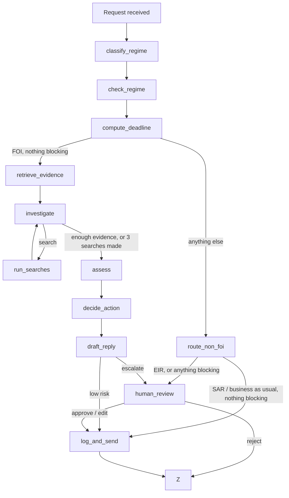

# FOI Agent

An agent that triages Freedom of Information (FOI) requests for a UK council. It works out which regime a request falls under, sets the deadline, checks what is already published and which exemptions might apply, and drafts a reply. It replies on its own only to signpost published information or to route a subject access request or service request. Everything else goes to an FOI officer with a suggested decision and draft.

**Start with [HANDOVER.md](HANDOVER.md)** for the results, what the evals taught me, known failures and how I'd evaluate it in production. This README covers setup and reference.

## Stack

- Python and LangGraph
- OpenAI `gpt-6-luna` for the regime check, assessment and drafting (`FOI_MODEL`)
- A decision model for regime classification, `semif-qwen3.5-4b` through `langchain-typesafe` and the LangSmith Gateway (`FOI_CLASSIFIER_MODEL`)
- BM25 retrieval (`rank-bm25`) over a small knowledge base
- LangSmith for tracing and evaluation, with an LLM judge on `gpt-5.5-2026-04-23` (`FOI_JUDGE_MODEL`)
- FastAPI, Jinja2 and HTMX for the demo UI

## Quickstart

Requires Python 3.11 or later.

```bash
python -m venv .venv
source .venv/bin/activate          # Windows: .venv\Scripts\Activate.ps1
pip install -e ".[dev]"
cp .env.example .env               # Windows: Copy-Item .env.example .env
```

Add `OPENAI_API_KEY` and `LANGSMITH_API_KEY` to `.env`. The LangSmith key is used for tracing and by the regime classifier.

```bash
python -m pytest
python -m ruff check .
```

The tests use fake models and make no API calls.

## Run it

```bash
python -m foi_agent "How much is the chief executive paid?" --received 2026-10-26
python -m foi_agent --file examples/requests.jsonl --line 5
```

Escalated cases pause for officer review. Add `--review approve` or `--review reject` to decide them. [examples/requests.jsonl](examples/requests.jsonl) holds sample requests. Replies go to `var/outbox/` and each case is appended to `var/case_log.jsonl`. Nothing is emailed.

### Demo UI

```bash
pip install -e ".[demo]"
python -m uvicorn foi_agent.web.app:app --reload
```

Open http://127.0.0.1:8000. **Triage** runs a request and streams its path through the graph, then shows the regime probabilities, the deadline, why it was sent, routed or escalated, the assessment, the draft and the checks. For a golden-set request it also shows the run against its label. **Review** is the officer's queue: send, edit or reject, and the decision is logged to LangSmith as feedback (`officer_review`, `draft_edited`).

Each triage is a full run with real model calls. **Show last run** replays a saved run without calling a model. Cases are kept in `var/web.sqlite`. The app has no login, so keep it on 127.0.0.1.

On Windows machines where the venv's `.exe` launchers are blocked, run commands through Python, for example `.venv\Scripts\python -m uvicorn foi_agent.web.app:app --reload`.

## How it works



| Node | Type | What it does |
| --- | --- | --- |
| `classify_regime` | Decision model | FOI, EIR, SAR or business as usual, with a probability for each. Sees the guidance for every regime |
| `check_regime` | LLM | An independent second view of the regime, without seeing the classifier's answer |
| `compute_deadline` | Code | 20 working days for FOI and EIR, excluding bank holidays in any part of the UK (FOIA s10(6)). One calendar month for a SAR. None for business as usual |
| `route_non_foi` | Code | Routes a SAR or business-as-usual case with a template acknowledgement if nothing blocks it. EIR, and anything blocked, escalates |
| `retrieve_evidence` | Retrieval | BM25 over the disclosure log, publication scheme and exemption guidance |
| `investigate`, `run_searches` | Tool use | Up to 3 more read-only searches before assessment. Turn off with `FOI_SEARCH_TOOL=0` |
| `assess` | LLM | Whether it's already published, possible exemptions, the recommended decision and the evidence relied on |
| `decide_action` | Code | Sends only a signpost to a retrieved published record, with no exemption beyond s21 and nothing blocking. Everything else escalates with reasons |
| `draft_reply` | LLM | The reply. Information an officer must supply is marked `[OFFICER: …]` |
| `human_review` | Interrupt | The officer approves, edits or rejects |
| `log_and_send` | Code | Writes the reply to the outbox and the case log |

An automatic send or route is blocked, and the case escalates, if the classifier's top regime is below 0.6, the regime check disagrees, or the request may not be in English.

## Evaluation

The golden set is [evals/datasets/golden.jsonl](evals/datasets/golden.jsonl): 63 labelled requests, 42 dev and 21 test. [evals/datasets/README.md](evals/datasets/README.md) explains the labels and slices.

```bash
python -m evals.upload_dataset                                  # push the dataset to LangSmith as foi-golden
python -m evals.run_experiment --split dev --limit 5            # a cheap first run
python -m evals.run_experiment --split dev                      # the dev split
python -m evals.run_experiment --split dev --no-search-tool     # without the search tool
python -m evals.run_experiment --split dev --classify-only      # the classifier only, no OpenAI calls
python -m evals.run_experiment --rescore EXPERIMENT --only no_wrong_auto_action   # new evaluators on an old run
```

Each case makes one OpenAI call for the regime check. An FOI case that reaches assessment makes 3 to 5 more, and the judge one per draft (`--no-judge` skips it). Summaries are saved to `evals/results/`.

| Evaluators | Where | What they score |
| --- | --- | --- |
| 8 label-free checks | [checks.py](src/foi_agent/checks.py) | Citations retrieved, assessment consistent, real FOIA sections, links from the evidence, no added personal data, rights stated, no placeholders in sent replies |
| 12 label checks | [evaluators.py](evals/evaluators.py) | Regime, regime check, action, `no_wrong_auto_action` (headline), `no_unsafe_send`, `sends_when_expected`, decision, published record, exemption recall and precision, deadline, retrieval recall |
| 2 trajectory checks | [evaluators.py](evals/evaluators.py) | `searches_made`, `tool_found_relevant` |
| LLM judge | [judge.py](evals/judge.py) | Whether the draft is right for the case, judged by its purpose (sent or escalated). Scored as `draft_judge_j2` |

The label-free checks also run on live traces, attaching scores as LangSmith feedback:

```bash
python evals/score_traces.py --dry-run   # print only
python evals/score_traces.py             # write to LangSmith
```

## Observability

Every run is traced to LangSmith. Each BM25 search is a retriever span showing the records it returned. Every trace carries `agent_version`, `model`, `classifier_model`, `prompt_version`, `retriever`, `retrieval_k`, `search_tool`, `max_searches` and `corpus_version` (a hash of the knowledge base). Experiments also record the judge and checks versions, and LangSmith adds the git commit. Traces store the request text in full, so a live deployment would need to mask personal data first.

## Knowledge base

The council, Northbrook Borough Council, is fictional. The data lives in [src/foi_agent/data/](src/foi_agent/data/):

| File | Contents |
| --- | --- |
| `regime_guidance.json` | ICO guidance summaries on FOI, EIR, subject access, business as usual and mixed requests |
| `exemption_guidance.json` | ICO guidance summaries on s12, s14, s21, s22, s31, s40, s41, s42 and s43 |
| `disclosure_log.json` | Past FOI and EIR responses (invented) |
| `publication_scheme.json` | Datasets the council publishes (invented) |
| `bank_holidays.json` | UK bank holidays for all three regions, 2019 to 2028, from [gov.uk](https://www.gov.uk/bank-holidays.json) |

The ICO summaries contain public sector information licensed under the Open Government Licence v3.0.
